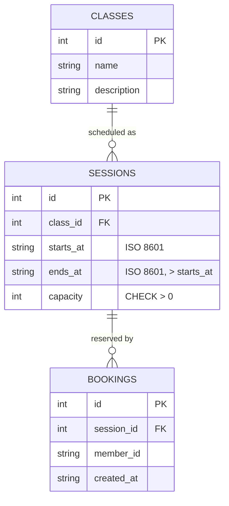

# Design — Gym Class Booking (baseline)

**Date:** 2026-08-21 (baseline) | **Last revised:** 2026-08-26

## Revision History

| Date | Change | Rationale / source |
|---|---|---|
| 2026-08-21 | Baseline design | Derived from BRD/PDR/NFR + UC-01/UC-02 |
| 2026-08-26 | Sessions gain a finish time (`ends_at`); schedule API validates `endsAt > startsAt`; timetable shows start–finish | Extend "Manage classes" (UC-02 A4 / PDR F4) |

## Problem

Members need to browse a class timetable and reserve a limited place; admins
need to keep classes and capacities current. The hard part is not the UI — it
is enforcing three invariants **consistently on the server**, regardless of
which client calls: a session is never overbooked, a member never holds two
bookings for the same session, and capacity is never set below what is already
booked. Cancelling must free a place immediately.

Traces to: BRD goals 1–4 · PDR F1–F4 · UC-01 (member) · UC-02 (admin).

## Data model

Three tables in a local SQLite database (see [ADR-0001](../ADR/0001-sqlite-local-db-file.md)).

- **classes** — a type of class (name + description).
- **sessions** — a scheduled instance of a class running from `starts_at` to
  `ends_at`, with a capacity. [Revised 2026-08-26] `ends_at` is stored as an
  ISO 8601 string alongside `starts_at`; the rule **`ends_at` must be strictly
  after `starts_at`** is enforced in the service layer (see API surface). Existing
  invariants (capacity, no double-book) are unchanged.
- **bookings** — a member's place in a session. `UNIQUE (session_id, member_id)`
  makes double-booking impossible at the storage layer as well as the service.

There is no `members` table: identity is a free-text `member_id` string (no auth
hardening — see NFR). `spots left` is **derived** (`capacity − count(bookings)`),
never stored, so it cannot drift.

## API surface

All rules live in the **service layer**; routes only validate shape and map
errors to status codes (`400` bad input, `404` not found, `409` conflict).

| Method | Path | Actor | Purpose |
|---|---|---|---|
| GET | `/api/timetable?memberId=` | Member | Sessions annotated with `spotsLeft`, `isFull`, `myBookingId`. |
| POST | `/api/bookings` | Member | Book `{ sessionId, memberId }` → `201`; `409` if full or already booked. |
| DELETE | `/api/bookings/:id?memberId=` | Member | Cancel own booking → `204`; `404` if not the member's. |
| GET | `/api/admin/classes` | Admin | Classes with their sessions and booking counts. |
| POST | `/api/admin/classes` | Admin | Create `{ name, description }` → `201`; `400` if name blank. |
| PUT | `/api/admin/classes/:id` | Admin | Edit name/description. |
| POST | `/api/admin/sessions` | Admin | Schedule `{ classId, startsAt, endsAt, capacity }`; `400` if `endsAt` missing or not after `startsAt`. [Revised 2026-08-26] |
| PUT | `/api/admin/sessions/:id/capacity` | Admin | Set capacity; `409` if below current bookings. |

Layering (per Coding-Conventions): **routes → services → data**. Rules never
leak into routes or the UI.

`scheduleSession(classId, startsAt, endsAt, capacity)` keeps all validation in the
service: `startsAt`/`endsAt` non-blank, `capacity` a positive integer, and
`endsAt` strictly after `startsAt` (compared as timestamps) — otherwise a
`ValidationError` (400) and nothing is saved. [Revised 2026-08-26]

_No ADR is warranted: adding a `ends_at` field and a start-before-finish check is
a straightforward field addition within the existing schema and service pattern,
not a new architectural decision or trade-off._

## Web routes

A single-page app with two tabs (no router needed at this size):

- **Timetable** — lists sessions with their **start–finish** time (e.g.
  `Tue Sep 1, 08:00–09:00`); a Book button on free sessions, Cancel on the
  member's own booking; full sessions show a "Full" tag and disable Book.
  [Revised 2026-08-26]
- **Admin** — create a class, schedule sessions, and adjust capacity inline.

A `member id` field stands in for auth so the flows can be demonstrated as
different members. The UI holds **no business logic** — it renders API results
and surfaces API error messages.

## Edge cases

| Case | Handling |
|---|---|
| Session full | `book()` throws `ConflictError` (409); UI disables Book and shows "Full". |
| Double-book | `book()` rejects if a booking already exists (409); `UNIQUE` backstops it. |
| Cancel frees a place | `cancel()` deletes the row; the derived `spotsLeft` rises immediately. |
| Cancel someone else's booking | `404` — a booking is only cancellable by its own `memberId`. |
| Capacity below bookings | `setCapacity()` throws `ConflictError` (409); equal-to-booked is allowed. |
| Invalid input | Blank name / non-positive capacity / missing `startsAt` → `ValidationError` (400). |
| Finish not after start | `scheduleSession()` throws `ValidationError` (400) when `endsAt` is missing or `endsAt <= startsAt`; nothing is saved. [Revised 2026-08-26] |

## Testing approach

- **Vitest** unit/service tests against an in-memory SQLite DB: capacity limit,
  double-book rejection, cancel-frees-place, admin CRUD, capacity-not-below-bookings.
- **Vitest + supertest** at the HTTP boundary: status codes for the seeded app.
- **Playwright** one e2e smoke: browse → book → cancel happy path.

See [test-strategy](../../Testing/Strategy/test-strategy.md).

## Out of scope (baseline)

Payments/memberships, real authentication, notifications, waitlist, recurring
bookings, cancellation-window rules (see the extra-feature backlog), deployment,
and visual/brand design.
