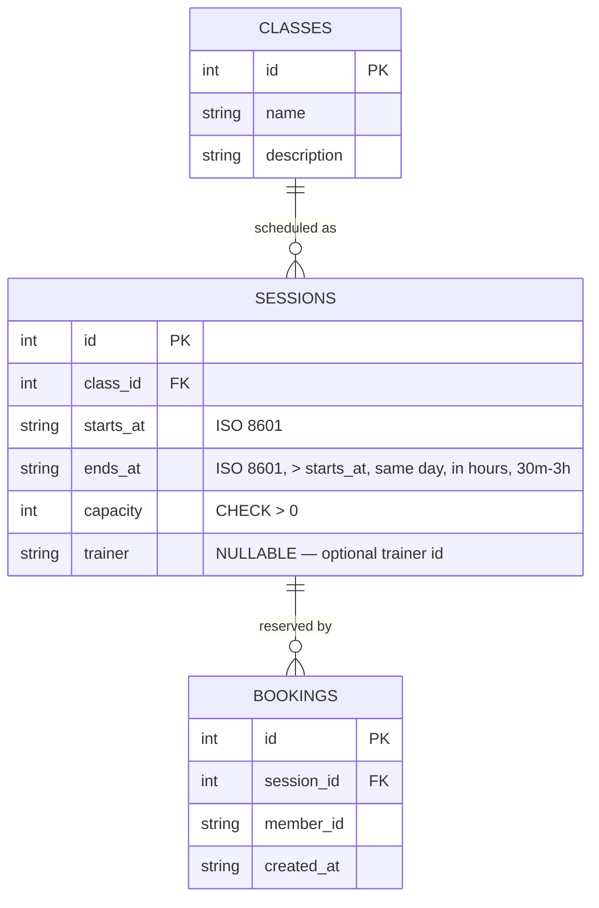

# Design — Trainer view (assigned sessions + rosters)

**Date:** 2026-08-26 (baseline) | **Last revised:** 2026-08-26

## Revision History

| Date | Change | Rationale / source |
|---|---|---|
| 2026-08-26 | Baseline design for the Trainer view increment | Derived from the extra-feature backlog (Trainer view) + UC-03 |
| 2026-08-26 | Implemented as designed (#5) — `sessions.trainer` column, `GET /api/trainer/:trainerId/sessions`, Trainer sidebar view + acting-as field, optional Admin trainer field | See [feature description](../../FunctionalRequirement/Feature/trainer-view.md) |

## Problem

A trainer needs to see, before a session, **which sessions they are running** and
**who is booked** on each. The baseline models members, classes, sessions, and
bookings but has no notion of *who teaches* a session, and no read path scoped to
a trainer. The hard part is not the UI — it is threading a new **optional**
attribute (`sessions.trainer`) through the schema, seed, and read model without
disturbing the three existing invariants (no overbooking, no double-booking,
capacity never below bookings) or the single-day scheduling rules.

Like members, a trainer is just an **id string** — there is no login, no
`trainers` table, no password. That "minimal auth, reuse the acting-as pattern"
choice is a real decision and is recorded in
[ADR-0003](../ADR/0003-trainer-role-minimal-auth.md).

Traces to: extra-feature backlog (Trainer view) · UC-03 (trainer).

## Data model change

One nullable column is added to the existing `sessions` table; no new tables.
The trainer roster is **derived** from the existing `bookings` rows — nothing new
is stored for it.



- **sessions.trainer** — a **nullable** free-text trainer id (no `trainers`
  table, mirroring the member-id treatment). `NULL` means "no trainer assigned".
  Set optionally by the admin when scheduling; the seed assigns trainers to some
  sessions and leaves others `NULL`. Added as `trainer TEXT` (nullable) — existing
  rows/inserts that omit it remain valid, so the change is additive.
- **roster** — **derived**, never stored: the member ids from `bookings` where
  `session_id` matches, plus their count. It always reflects current bookings, so
  it cannot drift (same principle as the derived `spotsLeft`).

Existing invariants and the single-day scheduling rules are unchanged; the trainer
is metadata on a session, not a constraint on booking or scheduling.

## API surface

The rule (there is only one: "an assigned trainer sees their sessions with
rosters") lives in the **service layer**; the route validates shape and maps
errors to status codes, consistent with the baseline **routes → services → data**
layering.

| Method | Path | Actor | Purpose |
|---|---|---|---|
| GET | `/api/trainer/:trainerId/sessions` | Trainer | Sessions assigned to `trainerId`, each with its roster (booked member ids) and count. |

`getTrainerSessions(trainerId)` returns the sessions whose `trainer` equals
`trainerId`, ordered by `starts_at`, each enriched with its class name and roster.
An unknown or empty trainer id yields an **empty list** (`200 []`), not a `404` —
"no sessions" is a valid, expected answer (UC-03 A1/A2).

Admin scheduling is extended, not replaced: `POST /api/admin/sessions` accepts an
**optional** `trainer` field alongside the existing `{ classId, startsAt, endsAt,
capacity }`. When present it is stored on the session; when absent the session has
no trainer. All existing scheduling validation (same-day, finish-after-start,
working hours, duration) is unchanged and still runs.

### Response shape

`GET /api/trainer/:trainerId/sessions` → `200` with an array of:

```jsonc
[
  {
    "sessionId": 12,
    "classId": 1,
    "className": "Yoga Flow",
    "startsAt": "2026-09-01T08:00:00.000Z",
    "endsAt":   "2026-09-01T09:00:00.000Z",
    "trainer":  "t-morgan",
    "roster":   ["m1", "zoe"],   // member ids booked on this session
    "booked":   2                // roster length; 0 for an empty roster
  }
]
```

- `roster` is the list of booked member ids; `booked` is its length (a convenience
  count, mirroring the timetable's `booked`).
- A session assigned to the trainer with no bookings appears with `roster: []`
  and `booked: 0` (UC-03 A3) — it is still listed because the trainer is assigned.

## Web routes

The single-page app gains a **third left-sidebar item**, alongside Timetable and
Admin (sidebar navigation defined in [ui-layout.md](ui-layout.md)):

- **Trainer** — a new view (`TrainerPage`) that lists the acting trainer's
  sessions. Each row shows the **class name**, **date**, **start–finish** time
  (e.g. `Tue Sep 1, 08:00–09:00`), the **roster** (the booked member ids), and the
  **count**. It is **read-only** — no Book/Cancel/schedule actions.
- **Trainer "acting as" field** — a trainer id field, styled and captioned exactly
  like the member field (visible "Acting as" label + helper text noting it is a
  demo stand-in for sign-in, no real authentication). It stands in for auth so the
  view can be demonstrated as different trainers. Which id field applies is the
  active view's own (the Trainer view reads the trainer id; the Timetable reads the
  member id) — see ADR-0003 for the "reuse the acting-as pattern" decision.
- **Empty state** — when the trainer id matches no assigned sessions (or is blank),
  the view shows a clear "no sessions assigned" message rather than an empty page
  or an error (UC-03 A1/A2).

The Admin schedule form gains an **optional "Trainer" input** (a text field for a
trainer id) next to the existing date / start / finish / capacity inputs; leaving
it blank schedules a session with no trainer. The UI holds **no business logic** —
it renders API results and posts the optional trainer id unchanged.

## Edge cases

| Case | Handling |
|---|---|
| Unknown trainer id | `getTrainerSessions()` returns `[]` → `200 []`; UI shows "no sessions assigned". No `404`. |
| Blank trainer id | Treated as "no match" → empty list / empty state; no session is attributed to a blank trainer. |
| Assigned session, no bookings | Listed with `roster: []` and `booked: 0` — shown because the trainer is assigned. |
| Session with no trainer (`NULL`) | Never appears in any trainer's list; `NULL` matches no trainer id. |
| Trainer id is also a member id | Independent namespaces; the trainer view keys only on `sessions.trainer`, the timetable only on `bookings.member_id`. No collision. |
| Schedule without a trainer | `trainer` omitted/blank on `POST /api/admin/sessions` → session saved with `trainer = NULL`; all other validation unchanged. |
| Roster consistency | Roster is derived from `bookings` at read time, so cancelling/booking is reflected on the trainer's next load — it cannot drift. |

## Testing approach

- **Vitest** unit/service tests against an in-memory SQLite DB: `getTrainerSessions`
  returns only the trainer's sessions; roster contents and counts match the
  bookings; an unknown trainer → `[]`; an assigned-but-unbooked session → empty
  roster; scheduling with and without an optional trainer.
- **Vitest + supertest** at the HTTP boundary: `GET /api/trainer/:trainerId/sessions`
  returns `200` with the expected shape for a seeded trainer and `200 []` for an
  unknown one; `POST /api/admin/sessions` accepts an optional `trainer`.
- **Playwright** one e2e smoke: open the Trainer view, act as a seeded trainer, see
  their sessions and rosters; act as an unknown trainer, see the empty state.

See [test-strategy](../../Testing/Strategy/test-strategy.md) and
[TF-06 — trainer view](../../Testing/TestScenarios/TF-06-trainer-view.md).

## No ADR warranted for the data/read change — one ADR for the auth choice

The schema column, the read endpoint, and the derived roster are **additive,
built on the existing schema and service pattern** — no new architectural
decision there (like the earlier `ends_at` addition). The one decision worth
recording is *how a trainer is identified*: an id with **no real auth**, reusing
the acting-as pattern rather than introducing login. That is captured in
[ADR-0003](../ADR/0003-trainer-role-minimal-auth.md).

## Out of scope

Trainer self-scheduling, editing sessions, messaging or notifying members,
payroll, multiple trainers per session, real authentication or trainer accounts,
and any change to the booking/capacity/scheduling rules (see the extra-feature
backlog "Out of scope" for Trainer view).
